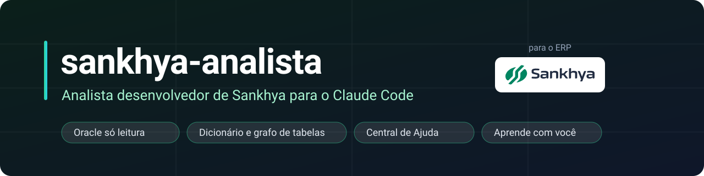
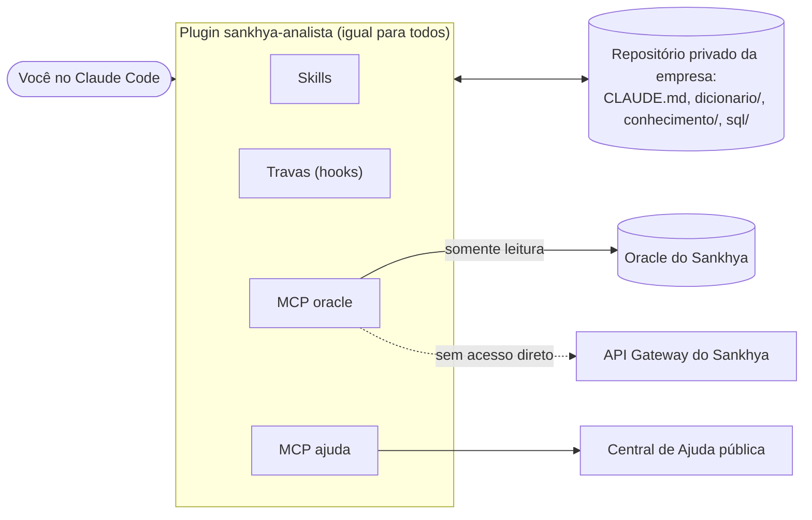

<div align="center">



<br>

[](https://github.com/Victups/sankhya-analista/actions/workflows/testes.yml)
[](https://github.com/Victups/sankhya-analista/tags)
[](LICENSE)
[](https://nodejs.org)
[](https://code.claude.com)
[](#segurança)

**Conecte o banco do seu Sankhya, só para leitura, e converse com um analista que conhece o dicionário, as ligações
entre as tabelas e a Central de Ajuda, e que aprende com a sua empresa.**

[Instalar](#instalar) ·
[O que faz](#o-que-faz) ·
[Como funciona](#como-funciona) ·
[Ferramentas](#ferramentas-e-skills) ·
[Segurança](#segurança) ·
[Configuração](#configuração) ·
[Contribuir](#contribuir)

</div>

---

## Por que existe

O Sankhya tem dezenas de milhares de campos, telas que gravam em mais de uma tabela e cada empresa com as suas
personalizações. Para achar a causa de um problema, quase sempre é preciso cruzar três coisas: o que a regra do
sistema diz (Central de Ajuda), como a sua empresa configurou (dados no banco) e o que mais mexe naquilo
(personalizações). O `sankhya-analista` junta as três na mesma conversa e entrega **a correção para alguém aplicar
pela tela**, nunca gravando no banco.

- **Só leitura de verdade.** A consulta passa por uma trava de SQL e roda em transação `READ ONLY`.
- **Campos que existem.** O agente confere cada campo no dicionário do *seu* banco antes de montar a consulta.
- **Memória da empresa.** O que se descobre vira nota num repositório privado seu, e o agente consulta da próxima vez.
- **Sem dado de uma empresa na outra.** O plugin é igual para todos; o conhecimento da empresa fica no repositório dela.

## O que faz

| Você pede | O plugin faz |
|---|---|
| "Apareceu `[CORE_E04176] Estoque insuficiente` ao faturar. De onde vem?" | Separa mensagem nativa de personalização, procura o texto no código do banco e nas regras de negócio (`investigar-trava`) |
| "Se eu apagar o campo `AD_MARGEM`, o que quebra?" | Varre gadgets, dashboards, botões, eventos, relatórios, regras e código do banco atrás do campo (`analise-impacto`) |
| "Monte uma consulta de vendas por mês" | Parte das consultas validadas, confere os campos no dicionário e valida no Oracle sem ler dado (`consulta-sql`, `validar_sql`) |
| "Como a tabela A se liga à B?" | Calcula o caminho de junção pelo grafo, com alternativas e `passar_por` (`caminho_entre_tabelas`) |
| "Preciso de um botão que faça X" | Escolhe o tipo certo (botão, evento, ação agendada, regra, Java, add-on) e escreve a proposta (`personalizacao`) |
| "Esse relatório formatado precisa mudar" | Guarda o original para desfazer, altera e documenta (`alterar-relatorio`) |
| "Preciso de um painel HTML5" | Parte de um componente base no padrão do Sankhya (`painel-html5`) |
| "O que a ajuda diz sobre isso?" | Busca na Central de Ajuda pública e lê o artigo (`buscar_ajuda`, `ler_artigo`) |

<details>
<summary><b>Exemplo de conversa</b> (ilustrativo, códigos fictícios)</summary>

<br>

```text
Você      Ao faturar o pedido: "[CORE_E04176] Estoque insuficiente. Empresa: 1 Produto: 100 Local: 0".
          De onde vem essa trava?

Analista  1. O prefixo CORE_ indica mensagem do núcleo do Sankhya. A Central de Ajuda (buscar_ajuda) traz
             o artigo oficial: ocorre quando o item é lançado sem os dados para buscar o saldo.
          2. Procurei o texto no código do banco (ALL_SOURCE): ele existe em objetos do próprio Sankhya, então
             não há indício de personalização. Não há regra de negócio ativa nessa TOP (TGFTRN).
          3. Consultei o saldo do produto 100: há estoque no local 1000, não no local 0 do item.

          Proposta para quem opera: relançar o item escolhendo o local 1000 (Comercial › Consulta de
          Produtos, para carregar local e controle na grade). Para desfazer: voltar o item ao estado anterior.
          Nada foi alterado no banco.
```

</details>

## Instalar

Precisa de [Claude Code](https://code.claude.com), Node.js 18 ou mais novo e acesso ao banco pela rede ou VPN.

```bash
# 1. uma vez por máquina: registrar o catálogo
claude plugin marketplace add Victups/sankhya-analista

# 2. numa pasta vazia (ou no clone de um repositório privado vazio): instalar só para esse projeto
claude plugin install sankhya-analista@sankhya-analista --scope project
```

3. O Claude Code pede as opções de conexão ao habilitar (depois: `claude plugin configure sankhya-analista`). A senha
   é digitada na tela dele e vai para o cofre de credenciais, nunca para o chat.
4. Escreva **começar**. Numa pasta nova onde o plugin foi habilitado, o próprio agente já oferece isso na primeira
   resposta.

A skill `comecar` monta o resto: copia a estrutura do repositório da empresa (sem sobrescrever nada), faz `git init`,
**oferece criar o repositório privado no GitHub** (só com o seu sim), testa a conexão, confere se o usuário só lê,
extrai o dicionário e **oferece o primeiro commit**. Só o nome da empresa é pergunta obrigatória; pode ser repetida
sem risco. Detalhes, estrutura de pastas e o que ela nunca faz em
[docs/repositorio-da-empresa.md](docs/repositorio-da-empresa.md).
# 2. na pasta do repositório da empresa: instalar só para esse projeto
claude plugin install sankhya-analista@sankhya-analista --scope project
```

3. O Claude Code pede as opções de conexão ao habilitar (depois: `claude plugin configure sankhya-analista`).
4. Abra o Claude Code na pasta da empresa e peça para **começar**: a skill `comecar` confere a conexão, os
   privilégios do usuário, extrai o dicionário e monta a estrutura do repositório da empresa.

> **Sem acesso direto ao Oracle (Sankhya na nuvem)?** Use o API Gateway: veja [Configuração](#configuração).

Instalado de um repositório git, o Claude Code instala as dependências sozinho. Catálogo em pasta local: rode
`npm ci` nela antes do primeiro uso.

## Como funciona



| Peça | Onde fica | O que guarda |
|---|---|---|
| **Plugin** | este repositório | skills, travas, os dois MCPs, conhecimento geral do Sankhya, modelos |
| **Repositório da empresa** | privado, um por empresa | `CLAUDE.md` com as decisões dela, `dicionario/` do banco dela, `conhecimento/`, `sql/`, `dashboards/`, `relatorios/`, `docs/`, e `dados/` (fora do git) |

Nada da empresa sobe para o plugin. O conhecimento geral só cresce por proposta revisada
(ver [Conhecimento e equipe](#conhecimento-e-equipe)).

## Ferramentas e skills

### MCP `oracle` (Oracle direto ou API Gateway)

| Ferramenta | Para quê |
|---|---|
| `consultar_sql` | Uma consulta `SELECT`/`WITH` em transação somente leitura; devolve as linhas em JSON |
| `validar_sql` | Confere sintaxe, tabelas e campos sem ler nenhuma linha (o Oracle só analisa) |
| `exportar_sql` | Resultado grande vai para `dados/` (fora do git); só o resumo volta à conversa |
| `resumir_dados` | Perfil, agrupamento, soma e filtro de um arquivo de `dados/`, sem trazer as linhas |
| `verificar_conexao` | Testa a conexão, mostra a versão do Sankhya e avisa se o usuário pode gravar |
| `extrair_dicionario` | Grava `dicionario/`: campos (com "existe no banco"), chaves, ligações e instâncias |
| `buscar_dicionario` | Acha tabela ou campo por nome, abreviação (Cód., Vlr., Dt.), sinônimo ou nome da tela |
| `descrever_tabela` | Campos e ligações de uma tabela, com filtro |
| `caminho_entre_tabelas` | Caminho de junção entre duas tabelas, com alternativas, `passar_por` e `evitar` |
| `buscar_conhecimento` | Notas da empresa, consultas validadas de `sql/` e conhecimento geral, por relevância |

As ferramentas de dicionário funcionam **sem conexão** depois da primeira extração. `base: producao | teste` escolhe a base.

### MCP `ajuda`

`buscar_ajuda` e `ler_artigo`: Central de Ajuda pública do Sankhya, direto na API, sem instalar nada. Opcional: o MCP
`sankhya-ajuda` completo (Docker e PostgreSQL com pgvector) busca por significado nos artigos e na comunidade;
quem o tiver registrado, as skills usam também.

### Skills

| Skill | Quando usar |
|---|---|
| `comecar` | Primeiro uso numa empresa: conexão, privilégios, dicionário e estrutura do repositório |
| `mapear-banco` | Extrair ou atualizar o dicionário e o grafo de ligações |
| `investigar` | Problema no Sankhya: erro, valor errado, rotina que falha, rejeição do eSocial |
| `investigar-trava` | De onde vem uma mensagem de bloqueio (nativa, regra de negócio, trigger, procedure, evento Java) |
| `analise-impacto` | O que depende de um campo, tabela adicional (`AD_`) ou objeto antes de mudar |
| `consulta-sql` | Montar, corrigir e validar consultas Oracle para análise ou painel |
| `painel-html5` | Dashboard HTML5 no padrão do Sankhya |
| `alterar-relatorio` | Mudar relatório formatado (`.jrxml`) guardando o original |
| `personalizacao` | Botão de ação, evento programável, ação agendada, regra de negócio, trigger e procedure, módulo Java, add-on, campo e tela adicional, com referência por tipo |
| `registrar` | Guardar o que se confirmou na nota da área |
| `propor-conhecimento` | Gerar proposta de conhecimento geral, sem dado da empresa |

## Segurança

O plugin foi desenhado para que o pior caso seja uma consulta lenta, nunca uma escrita.

- **Trava de SQL.** Só `SELECT`/`WITH`, uma instrução por vez, sem `FOR UPDATE`, sem `WITH FUNCTION`, sem db link e só com
  funções nativas do Oracle (função de banco ou de pacote pode gravar em transação autônoma).
- **Transação somente leitura.** Tudo roda em `SET TRANSACTION READ ONLY` e termina com rollback. Linhas, tamanho e
  tempo têm limite.
- **Segredo fora da conversa.** Senha no cofre de credenciais do Claude Code; mensagem de erro sai sem senha nem endereço.
- **Usuário só de leitura por padrão.** A skill `comecar` confere os privilégios e, se o usuário puder gravar, avisa e
  registra a decisão da empresa no `CLAUDE.md` dela.
- **Dados pessoais fora do git.** Ficam em `dados/`, e a trava impede que subam por engano.

| Trava (hook) | Bloqueia |
|---|---|
| Segredos | Ler ou expor `.env`, chaves e credenciais; ler o cofre de senhas pelo terminal |
| Banco por fora | `sqlplus`, `oracledb`... e os serviços web do Sankhya (`service.sbr`, `DbExplorerSP`, `CRUDServiceProvider`) pelo terminal |
| Git | `git add --force` e commit de `dados/`, planilhas, CSV e `Result_*.json` |

`node hooks/travas.mjs texto <arquivo>` confere se um texto tem dado de empresa (CPF, CNPJ, e-mail, IP, valor, código
local), segredo ou frase que pareça ordem ao agente.

> No modo API Gateway não existe transação somente leitura: a única proteção é a trava de SQL, e `verificar_conexao` avisa.

## Configuração


| Trava (hook) | Bloqueia |
|---|---|
| Segredos | Ler ou expor `.env`, chaves e credenciais; ler o cofre de senhas pelo terminal |
| Banco por fora | `sqlplus`, `oracledb`... e os serviços web do Sankhya (`service.sbr`, `DbExplorerSP`, `CRUDServiceProvider`) pelo terminal |
| Git | `git add --force` e commit de `dados/`, planilhas, CSV e `Result_*.json` |

`node hooks/travas.mjs texto <arquivo>` confere se um texto tem dado de empresa (CPF, CNPJ, e-mail, IP, valor, código
local), segredo ou frase que pareça ordem ao agente.

> No modo API Gateway não existe transação somente leitura: a única proteção é a trava de SQL, e `verificar_conexao` avisa.

## Configuração

<details>
<summary><b>Opções de conexão</b> (Oracle direto)</summary>

<br>

| Opção do plugin | Variável de ambiente equivalente | Para quê |
|---|---|---|
| `oracle_connect_string` | `ORACLE_CONNECT_STRING` | `host:porta/serviço` da produção |
| `oracle_user` | `ORACLE_USER` | usuário (de preferência só de leitura) |
| `oracle_password` (sigilosa) | `ORACLE_PASSWORD` | senha |
| `oracle_schema` | `ORACLE_SCHEMA` | dono das tabelas, quando o usuário é só de leitura |
| `teste_user` | `ORACLE_TESTE_USER` | usuário da base de teste (vazio: sem teste) |
| `teste_connect_string` | `ORACLE_TESTE_CONNECT_STRING` | vazio: o mesmo da produção |
| `teste_password` (sigilosa) | `ORACLE_TESTE_PASSWORD` | vazio: a mesma da produção |
| `teste_schema` | `ORACLE_TESTE_SCHEMA` | vazio: o próprio usuário de teste |

A opção vazia cai para a variável de ambiente. A senha vai para o cofre de credenciais do Claude Code, nunca para o
repositório. Para definir a variável no Windows sem a senha aparecer na tela nem no histórico:

```powershell
$s = Read-Host 'Senha do Oracle' -AsSecureString
[Environment]::SetEnvironmentVariable('ORACLE_PASSWORD', [Runtime.InteropServices.Marshal]::PtrToStringAuto([Runtime.InteropServices.Marshal]::SecureStringToBSTR($s)), 'User')
Remove-Variable s
```

Opcionais, só por variável: `ORACLE_CLIENT_LIB_DIR` (Oracle Instant Client, para banco anterior ao 12.1) e
`ORACLE_CALL_TIMEOUT_MS` (padrão 120000).

</details>

<details>
<summary><b>Sem acesso direto ao Oracle</b> (Sankhya na nuvem: API Gateway)</summary>

<br>

Preencha `api_client_id`, `api_client_secret` e `api_x_token` (ou `SANKHYA_CLIENT_ID`, `SANKHYA_CLIENT_SECRET`,
`SANKHYA_X_TOKEN`; `SANKHYA_API_URL` para o sandbox). As consultas vão pelo `DbExplorerSP.executeQuery`, com a mesma
trava de SQL, mas sem transação somente leitura. Base com Oracle direto configurado usa o Oracle; sem ele, usa a API.
Para outras bases ou conexões com nome, o padrão é o mesmo do Oracle (`SANKHYA_TESTE_CLIENT_ID`,
`SANKHYA_ACME_CLIENT_ID`...).

</details>

<details>
<summary><b>Outras bases e várias empresas na mesma máquina</b></summary>

<br>

- **Outras bases** (treinamento, homologação...): `ORACLE_<BASE>_USER` e, se forem diferentes da produção,
  `ORACLE_<BASE>_CONNECT_STRING`, `ORACLE_<BASE>_PASSWORD` e `ORACLE_<BASE>_SCHEMA`. O agente usa `base: treinamento`.
- **Várias empresas:** no `.claude/settings.json` do repositório de cada empresa, `"env": { "SANKHYA_CONEXAO": "ACME" }`.
  Nessa pasta o plugin passa a ler `ORACLE_ACME_CONNECT_STRING`, `ORACLE_ACME_USER`, `ORACLE_ACME_PASSWORD`,
  `ORACLE_ACME_SCHEMA` e, para outras bases, `ORACLE_ACME_TESTE_USER` etc. As senhas ficam em variáveis de usuário
  do Windows, nunca no repositório.

</details>

## Conhecimento e equipe

- **Mesma empresa:** um repositório privado, cada pessoa com o seu clone e a sua conexão (de preferência um usuário de
  banco só de leitura por pessoa). O conhecimento circula pelo git. O `.claude/settings.json` do repositório, criado
  pela skill `comecar`, aponta o catálogo e habilita o plugin para quem abrir a pasta.
- **Várias empresas:** cada uma com o seu repositório; nada passa de uma para outra. Todas instalam o plugin daqui.
- **Conhecimento geral** (`conhecimento-geral/`): o que vale para qualquer Sankhya, mais uma biblioteca de consultas
  em `conhecimento-geral/sql/` (vendas e compras, pagar e receber, saldo bancário, estoque, personalizações,
  admissões). Cada fato traz a origem e a situação (a validar, visto numa base, confirmado). O conhecimento da empresa
  prevalece.
- **Aprendizado geral:** a skill `propor-conhecimento` gera uma proposta sem dado da empresa, verificada por
  `travas.mjs texto`, e a pessoa envia (arquivo ou pull request em `propostas/`). O mantenedor revisa e publica.
  Nada entra no conhecimento geral sem revisão humana: memória compartilhada é alvo de envenenamento.

## Atualizar

```bash
claude plugin marketplace update sankhya-analista
claude plugin update sankhya-analista@sankhya-analista
```

## Contribuir

Fluxo de branches e publicação de versão em [docs/fluxo-de-branches.md](docs/fluxo-de-branches.md); decisões do projeto em
[docs/desenho.md](docs/desenho.md).

```bash
npm ci
npm run teste                       # SQL, dicionário, caminhos, Central de Ajuda, protocolo MCP, travas
claude plugin validate .            # manifestos
claude --plugin-dir .               # testar numa pasta de empresa sem instalar
```

- `node mcp/ajuda.mjs --teste-online` testa a Central de Ajuda com a API de verdade.
- O CI roda os testes em Linux e Windows, com Node 20 e 24.
- **Propostas de conhecimento** chegam como `propostas/AAAA-MM-DD-<tema>.md`. Revise se não há dado de empresa, inclua
  em `conhecimento-geral/`, suba a versão em `.claude-plugin/plugin.json` e publique.

## Créditos

Ideias aproveitadas, com código e texto próprios: mascarar segredo em mensagem de erro
([lab019/sankhya-mcp](https://github.com/lab019/sankhya-mcp), MIT); bloquear os serviços web do Sankhya e o cofre de
senhas pelo terminal (thiagoaataide/sankhya-mcp); achar a tabela pelo nome da tela e investigar a partir de um número
(delt4d/SankhyaMCP). Padrões de código Java reescritos de
[sankhya-developer/sankhya-exemplos-funcionais](https://github.com/sankhya-developer/sankhya-exemplos-funcionais) (MIT).
Biblioteca de consultas verificadas (Snowflake Cortex Analyst, Vanna); caminho de junção calculado pelo grafo; defesas
contra envenenamento de memória compartilhada (proveniência, revisão humana, separação por confiança).

## Aviso

Projeto independente e **não oficial**, sem vínculo, patrocínio ou endosso da Sankhya. "Sankhya" e a sua logomarca
pertencem aos seus titulares e aparecem aqui apenas para indicar com qual ERP o plugin trabalha. Use por sua conta e
risco: confira o que o agente propõe antes de aplicar no seu ambiente.

## Licença

[MIT](LICENSE) © 2026 Victor Pereira
